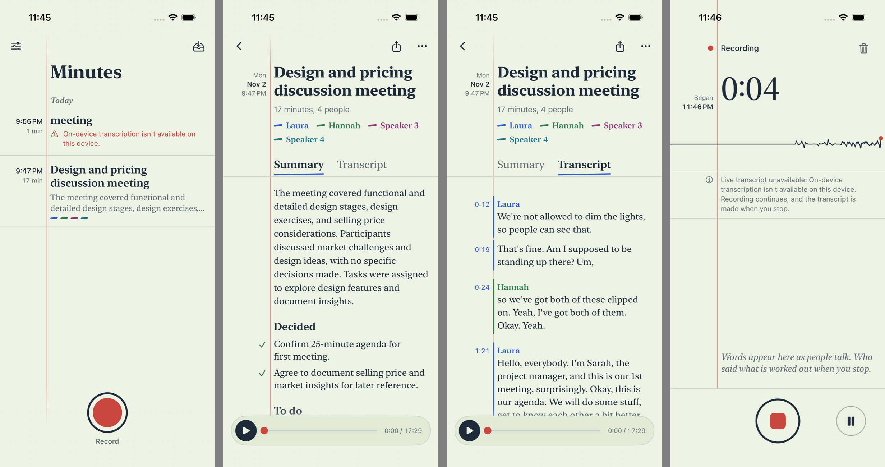
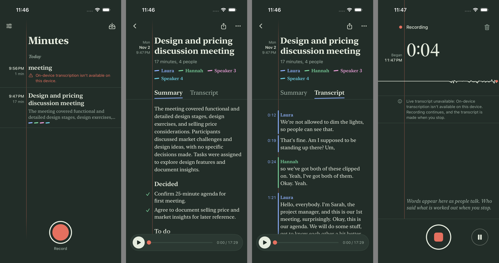
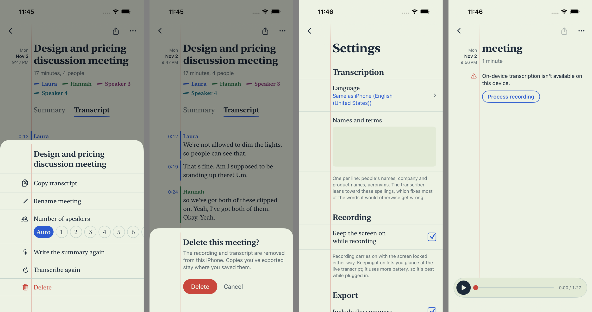
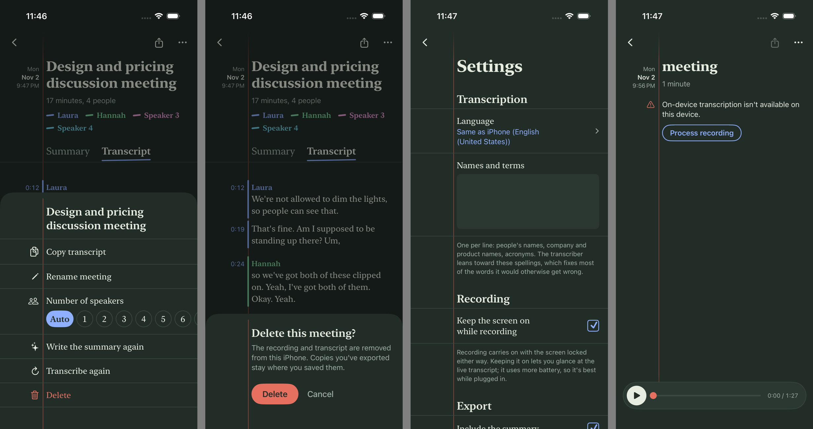
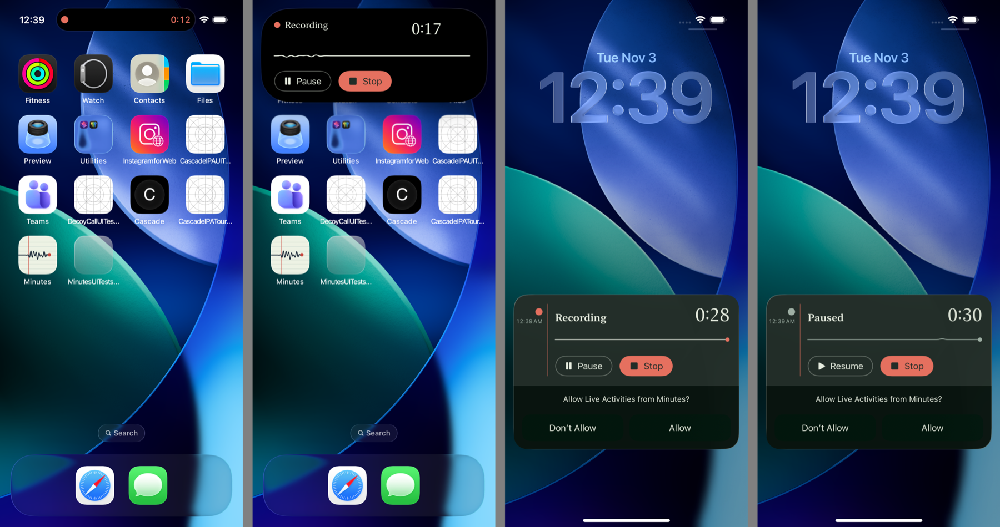

# Design: "Steno"

Minutes makes *the minutes* of a meeting, so the app is drawn as the tool stenographers used: a steno pad. Every screen is a page of that pad. It has pale green eye-ease paper, a red margin rule, and a ballpoint with several inks, one per speaker. The **margin holds when** (times, lengths, markers) and the **page holds what** was said.

Code: [Theme.swift](Minutes/Views/Theme.swift) has the tokens and shared pieces. Every screen builds from them.

| Light | Dark |
|---|---|
|  |  |
|  |  |

## Tokens

| Token | Light | Dark | Used for |
|---|---|---|---|
| `paper` | `#EDF2E4` | `#222D28` | page background |
| `paperRaised` | `#E2EAD6` | `#2B3832` | settings rows, the player |
| `rule` | `#C5D3CB` | `#394A41` | ruled lines between entries, track of progress lines |
| `margin` | `#C9473D` | `#E5705F` | the margin rule, the record key, problems |
| `ink` | `#1D2A3A` | `#E6ECDF` | text |
| `pencil` | `#5E6B72` | `#9DAEA3` | secondary text, the live transcript's in-progress words |
| `ballpoint` | `#2D5BD0` | `#8EB0FF` | controls, links, the first speaker |

Speaker inks, in order of who spoke first: ballpoint blue, green, plum, teal, ochre, brick (`Ink.color(for:)`). Dark mode is the same pad in low light: deep green-grey paper and paper-coloured ink, not a generic dark theme.

## Type

Two roles, no others.

- **New York** (`Typeface.page`) for everything written on the page: titles, transcript, summary, the recording clock.
- **SF Pro** (`Typeface.note`) for controls and margin notes.

Everything uses Dynamic Type text styles. Digits use `.monospacedDigit()`, never a mono face. Sentence case everywhere.

## Layout

- `PageMetrics`: an 18 pt edge, a margin column (62 pt, scaled with Dynamic Type), a 14 pt gutter. The red rule sits in the middle of the gutter, full height, on every screen (`PaperPage`).
- `MarginRow` is the unit of layout: margin note right-aligned against the rule, page content to its right. Page-only rows still reserve the margin (`BlankMargin`), so text never crosses the rule.
- Structure encodes information:
  - The list groups entries by day. Each entry's time and length sit in the margin, and its ruled line separates it from the next.
  - Summary markers sit in the margin: ✓ for decided, ○ for to do, – for discussed.
  - In the transcript, **the margin rule takes the speaker's ink** for as long as they talk.

## The one memorable element

The **pen trace** on the recording screen: input level drawn as one continuous ink line, like a chart recorder, with a red pen tip at the right edge. It is one wandering line, not a mirrored waveform. Each sample's wiggle comes from its absolute index, so the history scrolls without shimmering. Everything else stays quiet.

## Everything is drawn by the app

The owner asked that nothing look like a default iOS element, so the system's own components are all replaced:

| System component | Replaced by |
|---|---|
| Navigation bar, glass back button | `PageBar` + `BackKey` (ink chevron); `UINavigationController` keeps the edge swipe-back working |
| Menus, context menus, action sheets, alerts | `Pad` cards, a page torn off the pad sliding up over everything: `PadAction` rows, `ConfirmCard`, `NoticeCard`, `RenameCard` |
| Sheets (Settings) | a pushed page of the pad |
| List / Form cells, swipe actions | plain pages of `MarginRow`s; delete lives in the meeting's ⋯ card |
| Segmented picker | `InkTabs`: words with a ballpoint underline |
| Switches | `TickBoxStyle`: a box on a form, ticked in ballpoint |
| Text fields | `InkField`: a line to write on that turns blue while you type |
| Slider | `InkScrubber`: an ink line with a red playhead (a real `Slider` to VoiceOver) |
| Spinners | `InkProgress`: a line being inked left to right |
| Nested picker menu | `SpeakerCountRow`: numerals to pick from |

The share sheet, the Files picker and the keyboard stay iOS's own. They're how OneDrive, Files and typing work, and apps can't replace them.

## Deliberately not used

- Stock chrome: grey cards, and glass capsules behind toolbar icons.
- Generic-AI tells:
  - cream paper with terracotta;
  - near-black with one acid accent;
  - ALL-CAPS eyebrows;
  - meta strings joined with middle dots;
  - mono labels;
  - card grids with one radius and a soft grey shadow.
- Tried and cut:
  - a perforated edge on the record dock;
  - full-page ruled lines behind text (they can't stay aligned with Dynamic Type).

## Lock screen

The Live Activity is a card off the same pad. It has a paper background, a margin with the state mark (red dot recording, grey paused, a pencil while processing, a tick when done) and the start time, then the red rule. The page holds the status in New York, the clock, the pen trace as a `Shape` and the latest words. It follows the meeting past Stop through transcribing and the summary, and ends on the meeting's title for 15 minutes. If the app leaves the screen mid-processing the card says "Open Minutes to finish", because Apple Intelligence won't run in the background. The Dynamic Island uses the night inks (it's always black): a red dot and red clock when compact, trace and controls when expanded. Pause/Resume run as intents without opening the app. Stop opens Minutes, so processing has the app on screen.

Lock-screen widgets: the record key (circular), "Record a meeting" (inline) and the last meeting (rectangular, which needs the App Group, see `project.yml`). There's also a Record control for the lock screen's corners, Control Center and the Action button.

## Icon

The same page: green paper, ruled lines, the red margin, and a navy pen trace ending in a red tip. It has a dark variant ([AppIcon.appiconset](Minutes/Resources/Assets.xcassets/AppIcon.appiconset)).
